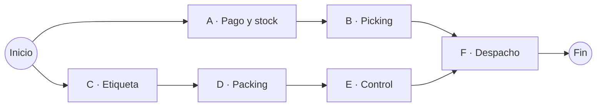
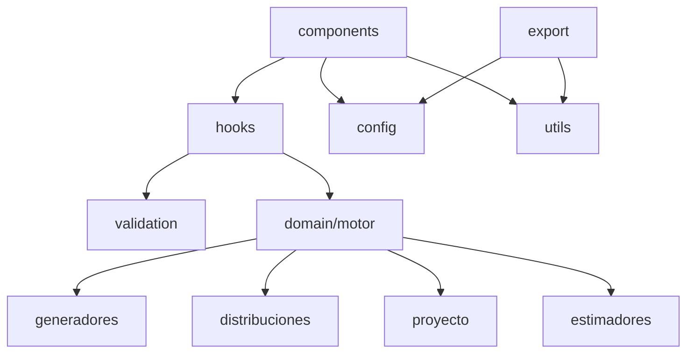
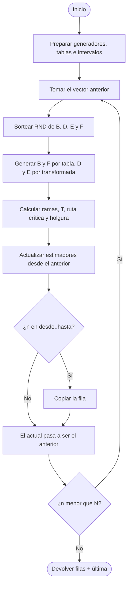

# SIM_2026_4K4_TP3 — Proyecto logístico sin memoria

Simulación Montecarlo del despacho de un pedido online, modelado como una red de actividades en paralelo. Trabajo Práctico 3 de **Simulación** (UTN FRC, 2026, curso 4K4).

La app tiene dos partes: una **presentación** en slides con las reglas del dominio y las decisiones tomadas, y un **simulador** con parámetros editables, estimadores, distribución de frecuencias, vector de estado y exportación a Excel.

---

## Cómo iniciar

Requiere Node.js 20 o superior.

```bash
npm install
npm run dev       # servidor de desarrollo en http://localhost:5173
npm run build     # compila a dist/
npm run preview   # sirve la versión compilada
```

---

## Contexto

Un pedido se despacha cuando se completan dos líneas de trabajo que arrancan al mismo tiempo: una busca el producto (A → B) y otra prepara la caja (C → D → E). El despacho (F) solo puede empezar cuando **ambas** terminaron.



La duración total de cada iteración es:

```
T = máx(A + B ; C + D + E) + F
```

La rama más lenta es la **ruta crítica**; la otra tiene una **holgura** igual a la diferencia entre ambas.

---

## Reglas del dominio

### Actividades y distribuciones (valores del enunciado)

| Act. | Descripción                  | Distribución         | Parámetros                           | Generación            |
| ---- | ---------------------------- | -------------------- | ------------------------------------ | --------------------- |
| A    | Verificación de pago y stock | Constante            | 15 min                               | No usa RND            |
| B    | Picking en almacén           | Discreta             | 20 / 30 / 40 con 0,25 / 0,40 / 0,35  | Tabla acumulada       |
| C    | Impresión de etiqueta        | Constante            | 5 min                                | No usa RND            |
| D    | Preparación de empaque       | Uniforme             | U[5; 25]                             | D = a + RND · (b − a) |
| E    | Control de calidad           | Exponencial negativa | media 5 min                          | E = −μ · ln(1 − RND)  |
| F    | Despacho y carga             | Discreta             | 15 (libre) / 25 (ocupado), 0,5 / 0,5 | Tabla acumulada       |

En las discretas, cada valor ocupa el intervalo de RND `[acumulada anterior; acumulada)`.

### Generador congruencial mixto

```
X(n+1) = (a · X(n) + c) mod m        RND = X / m ∈ [0; 1)
```

- Un generador **independiente por variable aleatoria**: B, D, E y F.
- Valores de prueba: X0 = 3922, a = 1221, c = 1714, m = legajo.
- El primer RND sale de X1; la semilla no se usa como RND.

### Precisión

Un único parámetro (completa, 4, 3 o 2 decimales) **trunca** todo número no entero en el momento de calcularlo: RND, D, E, T y estimadores. Nunca se redondea, porque un RND redondeado a 1 haría que la exponencial calcule ln(0). La pantalla también trunca al mostrar.

El Excel exporta los decimales truncados con la misma precisión que se ve en pantalla: la elegida, o 6 decimales si es "Completa" (valor de `DECIMALES_PANTALLA_COMPLETA`).

Para sumar otra precisión, agregar un objeto a `PRECISIONES` en `src/config/constantes.js`, por ejemplo `{ valor: 5, etiqueta: "5 decimales" }`. El valor debe ser un entero y conviene no pasar de 10.

---

## Estimadores

| Estimador                   | Cálculo                                                                                              |
| --------------------------- | ---------------------------------------------------------------------------------------------------- |
| Tiempo mínimo teórico       | Simulacro con el mínimo de cada actividad (E mínima = 0): máx(15 + 20 ; 5 + 5 + 0) + 15 = **50 min** |
| Tiempo promedio             | ΣT / n                                                                                               |
| Duración de cada actividad  | Promedio acumulado de B, D, E y F                                                                    |
| Proporción crítica          | Contador de cada rama crítica / n. F es crítica siempre                                              |
| Holgura promedio            | Suma acumulada de la holgura / n                                                                     |
| Tiempo a fijar al 95 %      | Percentil empírico de las primeras 99 T: posición ⌈0,95 · (99 + 1)⌉ = 95                             |
| P(T ≤ 60min) y P(T ≥ 90min) | Contador / n                                                                                         |
| Distribución de frecuencias | 10 intervalos desde el mínimo teórico: 9 de ancho 90 / 9 = 10 min y el último `[140; ∞)`             |

Todos se actualizan en cada iteración a partir del vector anterior.

---

## Cómo interpretar los resultados

| Estimador                   | Qué significa                                                                              |
| --------------------------- | ------------------------------------------------------------------------------------------ |
| T (variable objetivo)       | Cuánto tardó en salir ese pedido.                                                          |
| Tiempo promedio             | Cuánto tarda un pedido en promedio.                                                        |
| Duración de cada actividad  | Cuánto tarda en promedio cada tarea.                                                       |
| Proporción crítica          | Qué tareas conviene acelerar: las que más seguido demoran el despacho.                     |
| Holgura promedio            | Cuántos minutos, en promedio, le sobran a la rama que no es crítica.                       |
| Tiempo a fijar al 95 %      | El tiempo que se le puede prometer al cliente cumpliendo en al menos el 95 % de los casos. |
| P(T ≤ 60min)                | Qué parte de los pedidos sale en 60 minutos o menos.                                       |
| P(T ≥ 90min)                | Qué parte de los pedidos tarda 90 minutos o más.                                           |
| Distribución de frecuencias | Cómo se reparten los tiempos: dónde se concentran y qué tan dispersos son.                 |

**Ejemplo** con los valores por defecto y 1000 iteraciones:

- Tiempo promedio ≈ 66 min: un pedido tarda algo más de una hora en promedio.
- Tiempo a fijar al 95 % = 80 min: prometiendo 80 minutos se cumple en al menos 95 de cada 100 pedidos.
- P(T ≤ 60) ≈ 50 %: la mitad de los pedidos sale en una hora o menos.
- P(T ≥ 90) ≈ 0 %: casi ningún pedido tarda una hora y media o más.

Estos valores dependen de los generadores usados: con otros parámetros del GCM (o con un generador independiente por variable) cambian.

---

## El vector de estado, columna por columna

Cada fila de la tabla es una iteración. Las columnas se agrupan igual que en `src/config/columnasVector.js`.

**n**

| Columna | Qué es               |
| ------- | -------------------- |
| n       | Número de iteración. |

**Constantes**

| Columna | Qué es                                       |
| ------- | -------------------------------------------- |
| A       | Duración de la verificación de pago y stock. |
| C       | Duración de la impresión de etiqueta.        |

**B · Picking, D · Packing, E · Control, F · Despacho** (un bloque por variable aleatoria)

| Columna     | Qué es                                                                     |
| ----------- | -------------------------------------------------------------------------- |
| X           | Estado del generador congruencial de esa variable.                         |
| RND         | X / m, truncado a la precisión elegida.                                    |
| B/D/E/F     | Valor generado: B y F por tabla acumulada, D y E por transformada inversa. |
| Montacargas | Solo en F: "libre" (15 min) u "ocupado" (25 min).                          |

**Red del proyecto**

| Columna      | Qué es                                                  |
| ------------ | ------------------------------------------------------- |
| Fin A+B      | Minuto en que termina la rama del producto.             |
| Fin C+D+E    | Minuto en que termina la rama del empaque.              |
| Inicio F     | El mayor de los dos: F arranca cuando terminaron ambas. |
| T            | Inicio F + F: duración total del pedido.                |
| Ruta crítica | Rama que terminó más tarde ("A-B", "C-D-E" o "Ambas").  |
| Holgura      | Minutos que le sobraron a la otra rama.                 |

**Duración del proyecto**

| Columna          | Qué es                                |
| ---------------- | ------------------------------------- |
| Σ T              | Suma acumulada de T.                  |
| T promedio       | Σ T / n.                              |
| T mín. observado | El menor T visto hasta esa iteración. |

**Promedio por actividad**

| Columna                            | Qué es                                         |
| ---------------------------------- | ---------------------------------------------- |
| B prom., D prom., E prom., F prom. | Promedio acumulado de cada variable aleatoria. |

**Criticidad**

| Columna                 | Qué es                                                        |
| ----------------------- | ------------------------------------------------------------- |
| Cont. A-B / Cont. C-D-E | Veces que cada rama fue crítica (en un empate suman las dos). |
| Prop. A-B / Prop. C-D-E | Contador / n.                                                 |
| Holgura prom.           | Suma acumulada de la holgura / n.                             |

**Probabilidades**

| Columna                        | Qué es                            |
| ------------------------------ | --------------------------------- |
| Cont. T ≤ 60min / P(T ≤ 60min) | Veces que T ≤ 60 y su proporción. |
| Cont. T ≥ 90min / P(T ≥ 90min) | Veces que T ≥ 90 y su proporción. |

**Percentil**

| Columna     | Qué es                                                                |
| ----------- | --------------------------------------------------------------------- |
| T percentil | Tiempo a fijar: la T en la posición 95 de las primeras 99, ordenadas. |

**Frecuencias absolutas**

Una columna por intervalo (`[50; 60)`, `[60; 70)`, …, `[140; ∞)`) con cuántas T cayeron en cada uno hasta esa iteración.

### Ejemplo: iteración 1 con los valores por defecto

Los cuatro generadores tienen los mismos parámetros, así que B, D, E y F usan el mismo RND. Con precisión completa (en pantalla, 6 decimales truncados):

- X = 40476, RND = 40476 / 95000 = 0,426063.
- B = 30 (el RND cae en `[0,25; 0,65)`), D = 5 + 0,426063 · 20 = 13,521263, E = −5 · ln(1 − 0,426063) = 2,776179, F = 15 (montacargas libre, RND < 0,5).
- Fin A+B = 15 + 30 = 45, Fin C+D+E = 5 + 13,521263 + 2,776179 = 21,297442.
- Inicio F = máx(45; 21,297442) = 45, T = 45 + 15 = 60.
- Ruta crítica A–B, holgura = 45 − 21,297442 = 23,702557.

### Acumulados en las tres primeras iteraciones

| n   | T   | Σ T | T promedio | T mín. observado |
| --- | --- | --- | ---------- | ---------------- |
| 1   | 60  | 60  | 60         | 60               |
| 2   | 50  | 110 | 55         | 50               |
| 3   | 60  | 170 | 56,666666  | 50               |

Cada fila se calcula solo con la anterior: Σ T suma la T nueva, el promedio divide por n y el mínimo compara con el mínimo anterior. El promedio de la fila 3 aparece truncado (170 / 3 = 56,666…), nunca redondeado a 56,67.

**"T percentil" muestra "—" hasta la iteración 99**, porque necesita las primeras 99 T para ordenarlas. Desde la 99 queda fijo: las iteraciones siguientes no lo modifican.

---

## Por qué A–B casi siempre es la ruta crítica

- La rama A + B vale entre 35 y 55 min (15 + 20 a 15 + 40; promedio 15 + 31 = 46).
- La rama C + D + E promedia 5 + 15 + 5 = 25 min. Solo le gana a A + B si E, que es exponencial de media 5, sale muy grande.

Comparación aproximada (5 millones de iteraciones, valores por defecto):

| Estimador     | 4 generadores con los mismos parámetros | 4 generadores independientes |
| ------------- | --------------------------------------- | ---------------------------- |
| C–D–E crítica | ≈ 0,66 %                                | ≈ 2,8 %                      |
| P(T ≤ 60)     | ≈ 50 %                                  | ≈ 43,5 %                     |
| P(T ≥ 90)     | ≈ 0,09 %                                | ≈ 0,01 %                     |
| T promedio    | ≈ 66                                    | ≈ 66                         |

Con los mismos parámetros, B, D, E y F usan el mismo RND en cada fila y "se estiran juntas": cuando D y E salen grandes, B también, y la rama A + B sigue ganando. Eso distorsiona las proporciones y las probabilidades; por eso el enunciado pide un generador distinto por variable.

Más iteraciones no cambian estas probabilidades: solo las estiman con más precisión.

---

## Por qué el histograma se concentra en cuatro intervalos

Cuando A–B es crítica, T = 15 + B + F, y B y F son discretas:

| B \ F | 15 (libre) | 25 (ocupado) |
| ----- | ---------- | ------------ |
| 20    | 50         | 60           |
| 30    | 60         | 70           |
| 40    | 70         | 80           |

T solo puede valer 50, 60, 70 u 80. El máximo de esa rama es 80, por eso con los valores por defecto casi no hay datos desde `[90; 100)`: solo aparecen cuando gana C–D–E.

Con los mismos parámetros en los cuatro generadores, B y F salen del mismo RND, y cada tramo de RND fija una combinación:

| RND            | B   | F   | T   | Probabilidad |
| -------------- | --- | --- | --- | ------------ |
| `[0; 0,25)`    | 20  | 15  | 50  | 25 %         |
| `[0,25; 0,50)` | 30  | 15  | 60  | 25 %         |
| `[0,50; 0,65)` | 30  | 25  | 70  | 15 %         |
| `[0,65; 1)`    | 40  | 25  | 80  | 35 %         |

Eso explica la forma del histograma: cuatro barras con esas alturas y el resto casi vacío.

---

## Distribución de frecuencias e intervalos

Una **distribución de frecuencias** divide el rango de T en intervalos y cuenta cuántas T cayeron en cada uno (frecuencia absoluta) y qué parte del total representan (frecuencia relativa).

Cómo salen los 10 intervalos por defecto:

- El primero empieza en el **tiempo mínimo teórico**: 50 min.
- Los 9 primeros tienen ancho 90 / 9 = 10 min: `[50; 60)`, `[60; 70)`, …, `[130; 140)`.
- El último empieza 90 min después del primero y no tiene tope: `[140; ∞)`.

La notación `[a; b)` significa que **a está incluido y b no**. Por ejemplo, T = 60 cae en `[60; 70)`, no en `[50; 60)`.

Por qué importa ≤ contra <: T vale exactamente 60 muy seguido. Con los valores por defecto, P(T ≤ 60) ≈ 50 % pero P(T < 60) ≈ 25 %. Por eso respetamos literalmente los símbolos del enunciado.

---

## Empates en la ruta crítica

Si A + B = C + D + E, las dos ramas terminan en el mismo minuto: **las dos son críticas** y cada una suma 1 en su contador. Por eso las proporciones de criticidad pueden sumar un poco más de 100 %.

Con precisión completa un empate es prácticamente imposible, porque D y E tienen muchos decimales. Con 2 decimales es posible, pero raro.

---

## Glosario del código

- **parametro:** texto con puntos que indica dónde está un valor dentro del objeto de parámetros del formulario. Ejemplo: `"generadores.B.x0"` significa generadores → B → x0. Lo usan `CampoNumero`, `setCampo` y los errores de validación.
- **ruta / RUTAS:** siempre se refiere a la ruta crítica ("A–B", "C–D–E" o "Ambas").
- **vector anterior / actual:** el estado de la iteración previa y el de la que se está calculando. El motor solo guarda esos dos.
- **truncar:** cortar decimales sin redondear, con `crearTruncador`.

---

## Decisiones del grupo

| Tema           | Decisión                                                                            |
| -------------- | ----------------------------------------------------------------------------------- |
| Tiempo mínimo  | Teórico (50 min), así los intervalos quedan fijos antes de simular                  |
| Límites        | ≤ 60 y ≥ 90 literales; intervalos `[a; b)`. T puede valer exactamente 60, 70 u 80   |
| Generadores    | Uno por variable, con parámetros independientes                                     |
| Primer RND     | Sale de X1                                                                          |
| Conversión     | RND = X / m (no m − 1)                                                              |
| Precisión      | Truncar, nunca redondear                                                            |
| Empates        | Si A + B = C + D + E, las dos ramas cuentan como críticas                           |
| Percentil      | Empírico con las primeras 99 iteraciones (T no es normal)                           |
| Corte          | Por N iteraciones: el modelo no tiene reloj                                         |
| Filas visibles | Rango desde–hasta definido antes de simular; la última iteración se muestra siempre |
| Histograma     | Parámetro propio de observaciones; por defecto N                                    |

---

## Estructura del proyecto

```
src/
├── main.jsx                        # punto de entrada
├── App.jsx                         # alterna presentación ↔ simulador; guarda el estado
│
├── config/
│   ├── constantes.js               # legajo, portada, precisiones, topes
│   ├── parametrosPorDefecto.js     # valores del enunciado
│   └── columnasVector.js           # esquema único de columnas (tabla y Excel)
│
├── domain/                         # lógica pura, sin React
│   ├── generadores/congruencialMixto.js
│   ├── distribuciones/             # constante, uniforme, exponencial, discreta
│   ├── proyecto/redProyecto.js     # T, ruta crítica, holgura, mínimo teórico
│   ├── estimadores/                # acumuladores, percentil, distribución de frecuencias
│   └── motor.js                    # loop de N iteraciones con vector anterior/actual
│
├── validation/validarParametros.js # reglas por campo y cruzadas
├── hooks/                          # useParametros (formulario), useSimulacion (motor)
├── export/exportarExcel.js         # 4 hojas: vector, estimadores, frecuencias, parámetros
├── utils/                          # truncar, formato, resumen de estimadores, parametros (lectura de valores anidados del formulario)
│
├── components/
│   ├── presentacion/               # Deck, Reveal y las 8 slides
│   ├── diagramas/                  # RedProyecto y FlujoIteracion (SVG)
│   ├── parametros/                 # formulario en 4 grupos + campos reutilizables
│   ├── resultados/                 # estimadores, histograma, tabla virtualizada
│   └── simulador/Simulador.jsx
│
└── styles/                         # tema, presentación, simulador
```

### Dependencias entre capas



`domain/` no importa nada de React: se puede leer y probar por separado.

---

## Flujo del motor

El motor no guarda la tabla. Recorre las N iteraciones con dos vectores y solo copia las filas del rango pedido, más la última.



El único buffer extra son las primeras 99 T, necesarias para el percentil.

---

## Configuración

Todo lo fijo del trabajo está en `src/config/constantes.js`:

- `LEGAJO`: módulo m de los generadores (placeholder, reemplazar por el real).
- `PORTADA`: título, curso, grupo e integrantes. Si grupo o integrantes quedan vacíos, no se muestran.
- `MAX_ITERACIONES` y `MAX_FILAS_CAPTURADAS`: topes para no saturar el navegador.
- `DECIMALES_PANTALLA_COMPLETA`: decimales visibles cuando la precisión es completa.

Los valores iniciales del formulario están en `src/config/parametrosPorDefecto.js`; el botón "Restaurar valores del enunciado" vuelve a ellos.

---

## Exportación a Excel

Exporta exactamente lo que muestra la tabla: las filas del rango elegido y la última iteración (resaltada). Para exportar toda la simulación, usar "Mostrar todas las iteraciones" antes de simular.

Los decimales van truncados a la precisión elegida (6 si es "Completa") y siguen siendo celdas numéricas, así Excel puede operar con ellas. La hoja "Parámetros" conserva los valores tal como se cargaron.

| Hoja                        | Contenido                                               |
| --------------------------- | ------------------------------------------------------- |
| Vector de estado            | Encabezado agrupado en dos filas, igual que en pantalla |
| Estimadores                 | Valores finales y detalle por actividad                 |
| Distribución de frecuencias | Intervalos, frecuencia absoluta y relativa              |
| Parámetros                  | Los usados en la corrida                                |

---

## Tecnologías

| Uso                    | Herramienta                         |
| ---------------------- | ----------------------------------- |
| Interfaz               | React 19 + Vite                     |
| Tabla de muchas filas  | @tanstack/react-virtual             |
| Excel                  | exceljs (se carga solo al exportar) |
| Diagramas e histograma | SVG propio                          |
| Tipografía             | IBM Plex Sans                       |
